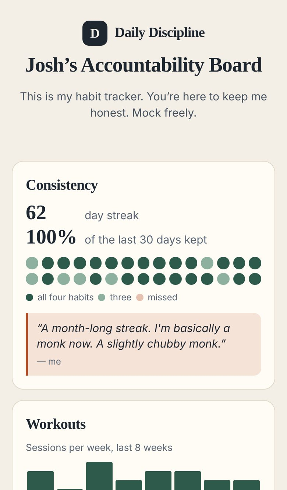
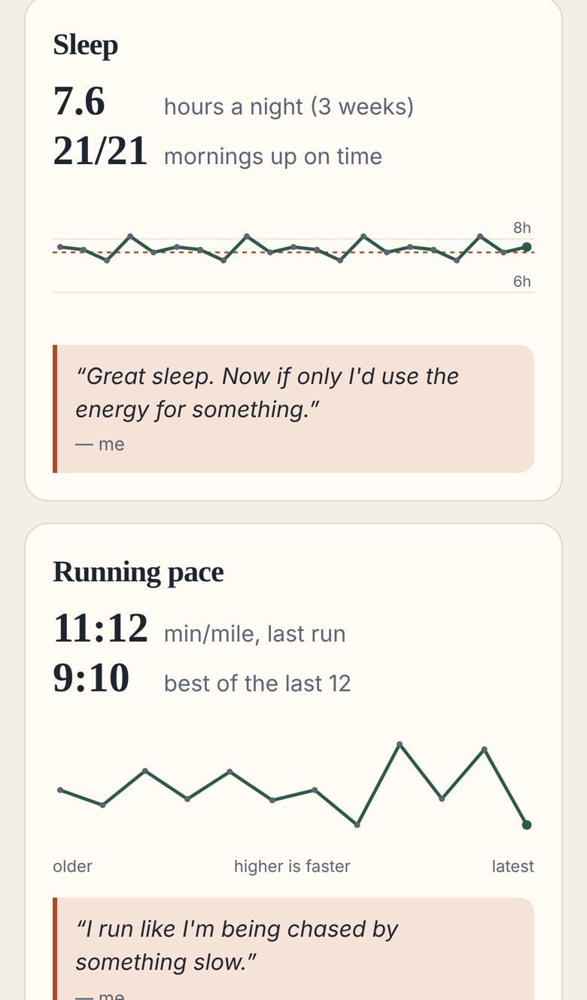
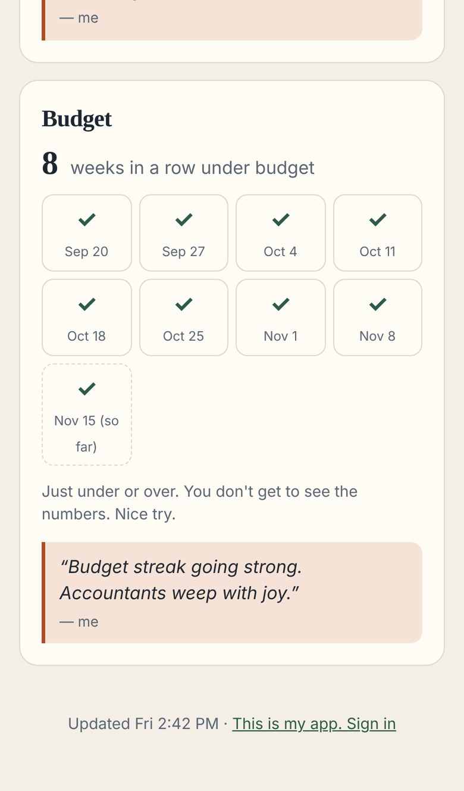
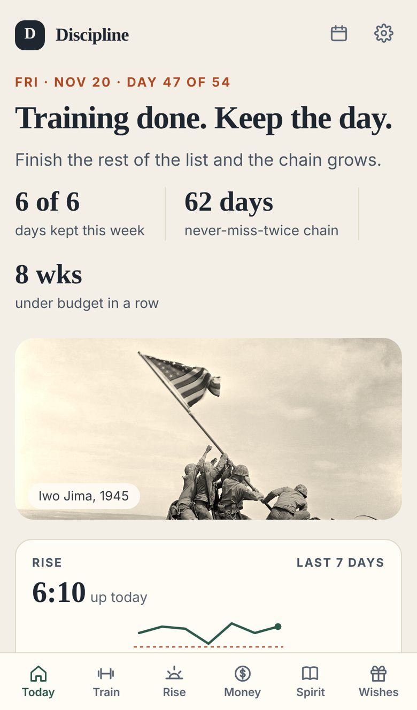
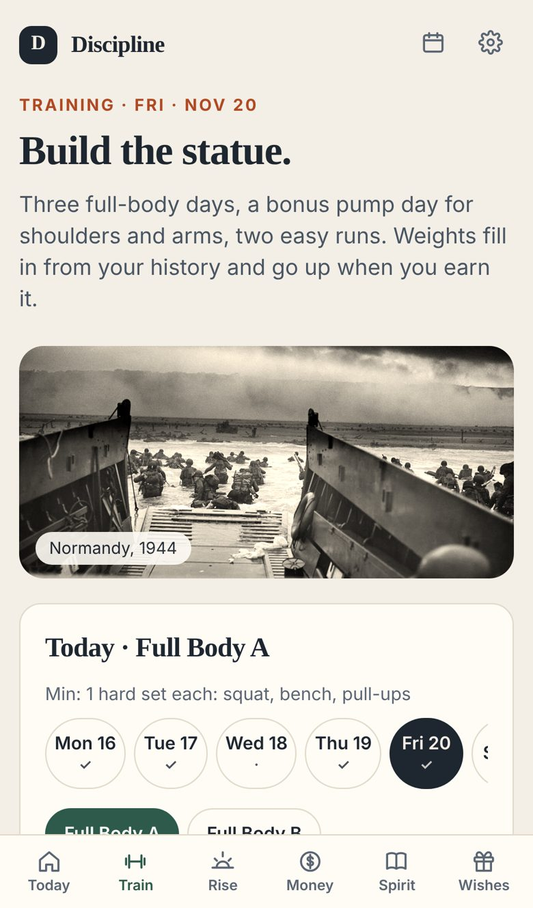

<h1 align="center">Daily Discipline</h1>
<h3 align="center">Rise. Train. Spend wisely. Pray. And now, get roasted for it.</h3>

<a href="https://joshp523.github.io/daily-discipline/"><b>▶ See my Accountability Board</b></a>

<table><tr>
<td align="center"> <b>The Accountability Board</b></td>
<td align="center"> <b>Sleep & pace</b></td>
<td align="center"> <b>Budget, no numbers</b></td>
<td align="center"> <b>Today</b></td>
<td align="center"> <b>Training</b></td>
</tr></table>

## ✦ Introducing the Accountability Board
**Your friends are watching.** Open the app without signing in and you get my public scorecard: streaks, workouts, sleep, running pace and bodyweight, in clean, honest charts.

**Self-roasting, built in.** Every chart comes with a line from me, about me, tuned to how I'm actually doing. Skip leg day and the app says so. Loudly.

**Budget, without the receipts.** Visitors see only a ✓ or ✗ for each week. No amounts, no bank, no business of yours.

**Always current.** The board refreshes itself every time I sync.

## ✦ The whole discipline, on one screen
- **Rise.** A wake-up target that glides earlier week by week, and sleep tracked from lights-out.
- **Train.** Three full-body days and easy runs, with smart weight suggestions and a stopwatch built in.
- **Money.** A weekly budget that pulls purchases straight from the bank.
- **Spirit.** Prayer and study, every day.
- **The chain.** Keep three of four and the streak grows. Never miss twice.

---

### On your phone
Open the link in Safari (iPhone/iPad) or Chrome (Android), then choose **Share → Add to Home Screen**. It gets its own icon and opens full-screen, just like an app from the store.

### More apps by Josh Riley
[The Riley Rag](https://joshp523.github.io/RileyRag/) · [QuipRash](https://joshp523.github.io/Quip-game-app/) · [Word Games](https://joshp523.github.io/Word-Games/) · [Russian Verbs](https://joshp523.github.io/russian/) · [Riley Rangers](https://joshp523.github.io/Rangers-app/) · [Habits: Meishe](https://joshp523.github.io/Habit-tracker-app-Meishe/) · [Habits: Grandma](https://joshp523.github.io/wendys-app/) · [Writing](https://joshp523.github.io/writing-app/)

Built by Josh Riley. Setup notes for whoever maintains it are in [SETUP.md](SETUP.md).
