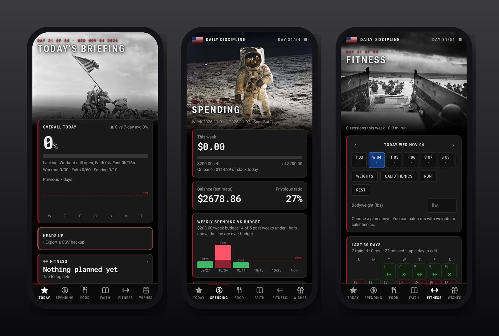
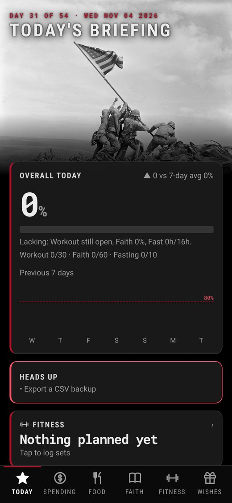
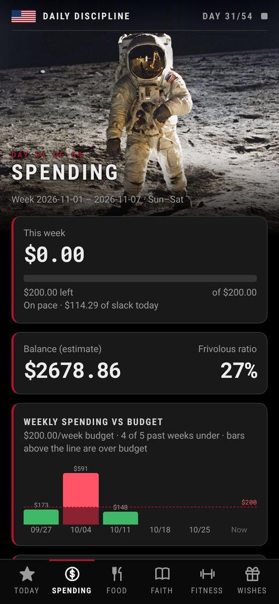
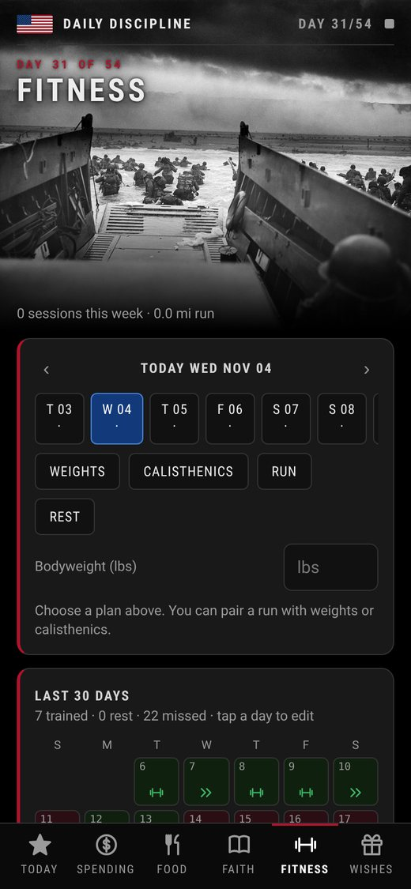

<h1 align="center">Habits: Josh (Daily Discipline)</h1>

<em>One screen, one question: how did I do today?</em>

<a href="https://joshp523.github.io/daily-discipline/"><b>▶ Open the app</b></a>

Daily Discipline is Josh's personal dashboard for a 54-day challenge. It pulls habits, money, food, faith and fitness into one daily score, with a bold black-and-white look inspired by historic photographs.

## The pages

- **Today:** the day's score, the last 7 and 30 days, and a "heads up" list of anything slipping.
- **Spending:** a weekly budget, category limits, live bank balances, and one-tap sorting of each transaction.
- **Food:** a fasting clock, a meal log, and a weight trend.
- **Faith:** a weighted daily habit score: rising early, study, prayer, journaling and more.
- **Fitness:** weights or a run (or both), logged set by set with a rest timer and progress charts.
- **Wishes:** shared wish lists. Tick off a gift without spoiling the surprise.

<table><tr><td align="center" valign="top"> Today</td><td align="center" valign="top"> Spending</td><td align="center" valign="top"> Fitness</td></tr></table>
## Why it's worth a look

- **Cool:** Every page opens on a dramatic historical photo. It feels like a war room for your own life.
- **Innovative:** Habits, money, food, faith and fitness roll up into a single honest number for the day.
- **Impressive:** It connects to the bank, syncs across devices, works offline, and shares a summary with Meishe's app.
- **Useful:** Instead of five different apps, one glance tells you what to fix before bedtime.

---

### On your phone
Open the link in Safari (iPhone/iPad) or Chrome (Android), then choose **Share → Add to Home Screen**. It gets its own icon and opens full-screen, just like an app from the store.

### More apps by Josh Riley
[The Riley Rag](https://joshp523.github.io/RileyRag/) · [QuipRash](https://joshp523.github.io/Quip-game-app/) · [Word Games](https://joshp523.github.io/Word-Games/) · [Russian Verbs](https://joshp523.github.io/russian/) · [Riley Rangers](https://joshp523.github.io/Rangers-app/) · [Habits: Meishe](https://joshp523.github.io/Habit-tracker-app-Meishe/) · [Habits: Grandma](https://joshp523.github.io/wendys-app/) · [Writing](https://joshp523.github.io/writing-app/)

Built by Josh Riley. Setup notes for whoever maintains it are in [SETUP.md](SETUP.md).
